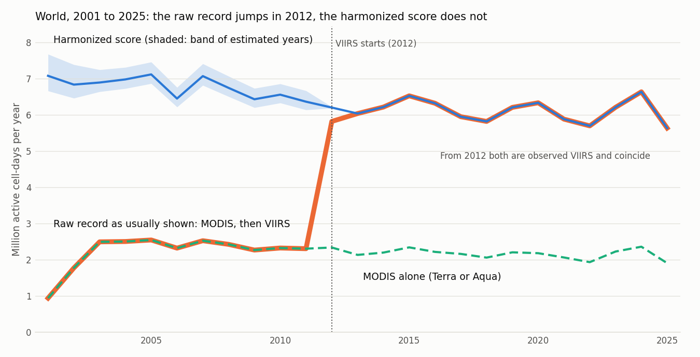

# The Hotspots

**One burning activity calendar for any place on Earth, from NASA's MODIS and VIIRS active fire records, 2000 to 2026.**

NASA Space Apps Challenge 2026, challenge [Harmonization of MODIS and VIIRS Hot Spots](https://www.spaceappschallenge.org/2026). Team page: [the-hotspots](https://www.spaceappschallenge.org/2026/find-a-team/the-hotspots/). Local event: Turin, Italy.

- **Try it** (works best in Italy): https://alonresearch.github.io/the-hotspots/, for example [Turin](https://alonresearch.github.io/the-hotspots/#map=9/45.07/7.69&month=2025-08&place=p:45.0700,7.6900&label=Turin) or [Foggia](https://alonresearch.github.io/the-hotspots/#map=9/41.46/15.54&month=2025-08&place=p:41.4600,15.5400&label=Foggia).
  - **Hosted demo limits:** the app has no server and reads precomputed files. The full world build is 2.78 GB ([web/README.md](web/README.md#deploy-static-host)), and free static hosting allows 1 GB, so the hosted demo carries the whole world at coarse resolution, the world totals and the 2027 forecast, and full detail (36 km² hexagons, place history, calendar) only for Italy. Outside Italy a place shows no history. This is a hosting limit, not a method limit: the full build runs locally (see [Contributor.md](Contributor.md) and [web/README.md](web/README.md)), and the demo video is recorded from it.
- **Demo video (30 s)**: <!-- TODO: demo video link --> link to follow
- **Source code**: https://github.com/AlonResearch/the-hotspots
- **Method paper**: [Whitepaper.md](Whitepaper.md) (equations, validation tables, limitations)

<!-- TODO: screenshots of the world map, the History panel, a low-confidence place, the 2027 forecast, scientific mode and the phone layout, taken from the hosted app. -->

---

## The problem

Satellites have recorded active fires since 2000, but the record is split between two sensors. MODIS (on Terra and Aqua, from 2000) has a pixel of about 1 km. VIIRS (on S-NPP, NOAA-20 and NOAA-21, from 2012) has a 375 m pixel and detects many more, smaller fires. A raw count of hotspots therefore jumps in 2012. That jump is a change of sensor, not a change in fire, but a map or chart that joins the two records shows it as a rise in burning.

The record is also changing now: S-NPP data delivery to FIRMS ended on 2 November 2026, and Terra and Aqua are drifting and expected to end in 2027 (sources in [Whitepaper.md](Whitepaper.md), section 1). A long record that is to continue has to be expressed in VIIRS terms.

**Who it is for** ([Vision Docs/Personas.md](Vision%20Docs/Personas.md), a draft): regional fire planners and operations desks who need to know when a place usually burns and whether this year is unusual; scientists and risk modellers who need one comparable series across 26 years; and land owners or farmers who want to know their own area. The question we answer first is: "is this place burning more than usual, and since when?"

## What you can do in the app

- **See the world map** of fire activity in hexagons (H3 grid), coloured by how many days had fire per 1,000 km².
- **Pick a place**: search a name or coordinates, tap the map, or draw an area.
- **Read its history**: a time strip and a calendar from November 2000 to November 2026, with the typical months, the months that were more or less active than usual, and which hexagons make up a peak.
- **See how far each value can be trusted**: every month has a confidence level (high, medium or low), drawn on the strip, the calendar and the map.
- **Look at 2027**: a forecast per month, greyed and labelled as a forecast, plus a "Next 12 months" list for the place.
- **Scientific mode**: the raw MODIS and VIIRS series next to the harmonized one, the uncertainty band, the check at each change of satellite, the method tables and CSV downloads.
- **Use it on a phone**: every feature works by touch (tested with touch emulation in Chromium and WebKit at phone sizes, not yet on real devices).

What is a **demo** and not backed by data is listed in [What is demo](#what-is-demo).

## NASA data used

All fire data come from **NASA FIRMS** (Fire Information for Resource Management System), [Archive Download](https://firms.modaps.eosdis.nasa.gov/download/), world, CSV, requested on 14 November 2026. In total 59 CSV files and 660 million detections, from 1 November 2000 to 14 November 2026.

| Sensor and satellite | Product | Period used |
|---|---|---|
| MODIS, Terra and Aqua | Collection 6.1 active fire, 1 km (archive folder `M-C61`) | 2000-11-01 to 2026-11-14 (Aqua from 2002-07-04) |
| VIIRS, Suomi NPP | Collection 2 active fire, 375 m (`SV-C2`) | 2012-01-20 to 2026-11-02 (end of FIRMS delivery) |
| VIIRS, NOAA-20 | Collection 2 active fire, 375 m (`J1V-C2`) | 2018-04-01 to 2026-11-14 |
| VIIRS, NOAA-21 | Collection 2 active fire, 375 m (`J2V-C2`) | 2023-03-01 to 2026-11-14 (shown per satellite; not yet in the score) |

The historical record uses the standard (science quality) files. The last months (2026-08 to 2026-11) use the near-real-time files and are marked **provisional** in the app.

DOIs of the near-real-time products, from their NASA Earthdata catalog pages:
[MCD14DL C6.1 NRT](https://www.earthdata.nasa.gov/data/catalog/lancemodis-mcd14dl-6.1nrt) 10.5067/FIRMS/MODIS/MCD14DL.NRT.0061;
[VNP14IMGTDL NRT](https://www.earthdata.nasa.gov/data/catalog/lancemodis-vnp14imgtdl-nrt-2) 10.5067/FIRMS/VIIRS/VNP14IMGT_NRT.002;
[VJ114IMGTDL NRT](https://www.earthdata.nasa.gov/data/catalog/lancemodis-vj114imgtdl-nrt-2) 10.5067/FIRMS/VIIRS/VJ114IMGT_NRT.002;
[VJ214IMGTDL NRT](https://www.earthdata.nasa.gov/data/catalog/lancemodis-vj214imgtdl-nrt-2) 10.5067/FIRMS/VIIRS/VJ214IMGT_NRT.002.
<!-- TODO: DOIs of the standard archive products (MODIS MCD14ML C6.1, VIIRS 375 m C2 for S-NPP, NOAA-20, NOAA-21). Not found on an official NASA page during the hackathon. -->

FIRMS reference: Davies, D. K., Ilavajhala, S., Wong, M. M. and Justice, C. O. (2009). Fire Information for Resource Management System: Archiving and Distributing MODIS Active Fire Data. *IEEE Transactions on Geoscience and Remote Sensing* 47(1), 72 to 79. doi:10.1109/TGRS.2008.2002076 (as listed on the [FIRMS FAQ](https://www.earthdata.nasa.gov/data/tools/firms/faq)).

No other datasets are used in the computation. The basemap is [OpenFreeMap](https://openfreemap.org/) (OpenStreetMap data), with a bundled [Natural Earth](https://www.naturalearthdata.com/) fallback.

## How the harmonized score works

The full method, with equations, is in [Whitepaper.md](Whitepaper.md), section 3. Every setting is in `pipeline/config.toml` or `web/src/stats/config.ts`.

1. **Filter.** Only detections of type 0 (presumed vegetation fire) with nominal or high confidence count, the same for both sensors. MODIS confidence (0 to 100) is mapped to the VIIRS classes: nominal 30 to 79, high 80 and above. Near-real-time files have no type column, so a fixed mask removes cells that were mostly volcanoes, gas flares or other static heat sources in 2021 to 2025.
2. **One unit: active cell-days.** The world is cut into hexagons of about 36 km² (H3 resolution 6). For each hexagon and UTC day we ask: did a satellite see at least one qualifying fire? A month's value is the number of (hexagon, day) pairs with a yes. Counting days instead of detections removes most of the pixel-size difference: VIIRS splits one fire into many detections, but it is still one day in that hexagon. A larger area is the exact sum of its hexagons, so every number on screen adds up.
3. **Join the sensors.** From February 2012 the value is what VIIRS saw (mean of S-NPP and NOAA-20 when both have every day of the month). Before that, MODIS cell-days are multiplied by a ratio fitted on the years both sensors flew (2012-02 to 2019-12, 93 months), per large region (H3 resolution 1, about 600,000 km²) and per season. Worldwide, VIIRS sees 2.47 to 3.06 times as many cell-days as MODIS, depending on season. Before October 2002 only Terra flew, and a separate Terra-only ratio (7.3 to 8.2) is used. Estimated months carry a band from resampling the fit years.
4. **"More than usual".** A month is compared with the same calendar month in 2012 to 2025, leaving out the year itself. Above the 90th percentile of those years is "much more than usual", above the 75th "more than usual", below the 25th "quieter than usual". The baseline uses only observed VIIRS years, so a recent month is never compared with estimated ones.

[Contributor.md](Contributor.md), section "How the fire score works", explains each choice for a general reader, with the literature behind it in [Vision Docs/Unified Score Research.md](Vision%20Docs/Unified%20Score%20Research.md).

*World totals per year, 2001 to 2025. Orange: the raw record as maps usually join it (MODIS until January 2012, VIIRS after), with the jump in 2012. Blue: the harmonized score, with its band for estimated years. From [Whitepaper.md](Whitepaper.md), Figure 1; script `scripts/whitepaper_figure.py`.*

## Validation

**Leave one year out** ([Whitepaper.md](Whitepaper.md), section 4.2). Each of the 8 overlap years is predicted from the other 7 (ratio times MODIS) and compared with what S-NPP saw that year.

- **Totals are right on average.** Predicted totals are 0.4% above observed (bias 1.004). By held-out year the bias runs from 0.988 to 1.028. Of the 350 regions with enough fire, 87.4% are within 10% of 1.
- **Small places are not.** The share of active months where MODIS saw nothing (so the estimate is zero) falls with area size:

| Unit | Area | Active months missed by MODIS |
|---|---|---|
| One hexagon | about 36 km² | 53% |
| 7 hexagons | about 250 km² | 47% |
| 49 hexagons | about 1,800 km² | 41% |
| Region | about 609,000 km² | 15% |

Where MODIS did see fire, the estimate is about twice too high for areas up to 49 hexagons (75th percentile 13.6 predicted against 7.0 observed at 7 hexagons). The errors cancel in large areas and not in small ones.

- **Drift.** A fit on 2020 to 2025 gives ratios 1% to 3% higher than the 2012 to 2019 fit, consistent with the known drift of Terra and Aqua. That fit is reported, not applied (Table 1 of the Whitepaper).
- **Outages.** Satellite outages are found from the files and listed as known issues. The detector finds the two largest MODIS and VIIRS discrepancies reported by Giglio et al. (2025): Aqua in August 2020 and S-NPP in July and August 2022 (Whitepaper section 4.4).

## Confidence levels and limits

Because of the table above, every value in the app has a confidence level ([Whitepaper.md](Whitepaper.md), section 3.9):

| Level | When | In the app |
|---|---|---|
| High | Seen by VIIRS (February 2012 on) | Solid bars |
| Medium | Estimated from MODIS for an area of 49 hexagons (about 1,800 km²) or more, or a provisional recent month | Hatched or dotted bars |
| Low | Estimated for a smaller area, or any month before October 2002 (Terra alone) | Faded bars, a "Low confidence" marker, one line of explanation, and no "more than usual" label |

Limits we state openly (full list: [Whitepaper.md](Whitepaper.md), section 7):

- **Small places before 2012 cannot be fixed with the data.** No ratio can recover fires MODIS never detected, and VIIRS did not exist before 2012 to check a correction. The app shows those values faded rather than hiding them, because no better number exists.
- **Medium is not exact.** At 49 hexagons, 41% of active months are still missed. Medium means "totals usable".
- **Active cell-days are not burned area.** They measure how widespread and how persistent burning was.
- **The ratio is fixed over time.** Any change in the MODIS to VIIRS relation before 2012 cannot be measured.
- **UTC days**, not local days; the ratio absorbs this on average, not per hexagon.
- **The last months are provisional** (near-real-time files), and November 2026 is partial (14 of 30 days).

## 2027 forecast

Documented in [Prediction.md](Prediction.md) and [Vision Docs/PredictionEngineeringReport.md](Vision%20Docs/PredictionEngineeringReport.md); code in [`forecast/`](forecast/).

- **What it predicts**: for each of 67,422 areas of about 1,800 km² (H3 resolution 4) and each month of 2027, the number of VIIRS (NOAA-20) active cell-days, as a median and a 10% to 90% range.
- **How**: LightGBM quantile regression on 21 features from fire history (2018-04 to 2026-10). Features stop at 31 October of the year before, as for the real 2027 forecast.
- **Held-out test** on two years never seen in training (2025, and 2026 January to October):

| | 2025 | 2026 (Jan to Oct) |
|---|---|---|
| Mean absolute error per area and month, model | 3.39 | 3.60 |
| Same, "usual value for that month" baseline | 3.39 | 3.74 |
| Observed value inside the 10% to 90% range | 90% | 89% |
| "Will this area burn this month?" right | 84.5% | 84.3% |
| World monthly total, average error | 10.8% | 7.9% |

- **Honest reading**: the model matches the usual-season baseline in 2025 and beats it by 3.6% in 2026. Almost all of its skill is the usual season of each area. It is an outlook from fire history, **not a weather forecast**: it cannot foresee an unusually dry or wet 2027.
- **Two differences from the harmonized record**: the forecast predicts NOAA-20 cell-days, learned from 2018 on (MODIS is only an input), not the harmonized score; and NOAA-20 sees about 2% more cell-days than S-NPP, so the forecast sits about 1% above the record's scale (not corrected). Details: [GroundTruth.md](GroundTruth.md), section 3h.

## What is demo

- **Why and What to do** for four places in Italy (Turin, Milan, Monte Barone, Foggia) show how a later version should explain the drivers of fire risk and suggest actions ([Vision Docs/Insight Engine.md](Vision%20Docs/Insight%20Engine.md)). The content comes from if/else rules written by us (`web/src/insight/demo.ts`). **No driver data (weather, soil moisture, vegetation) and no model is behind it.** The app marks these sections "Demo".
- **Daily views** exist only for Piedmont and its neighbouring regions; elsewhere the app is monthly.
- **The hosted demo** has full place history for Italy only (see the hosted demo limits at the top). The full world build runs locally.
- What a product would need next (not decided): [Vision Docs/Product Roadmap.md](Vision%20Docs/Product%20Roadmap.md).

## The team

| Member | Role |
|---|---|
| Arthur Alonso ([@AlonResearch](https://github.com/AlonResearch)) | AI, UI/UX |
| Nurbanu Koc | Science and pitch |
| Bekhzod Anvarov | Programming and AI |

## Use of AI

The code was written with AI coding agents run through T3 Code (Claude and Gemini). The team made the idea, the design and product decisions and the method decisions, and checked the results. The demo content for four places in Italy (`web/src/insight/demo.ts`) was also written with T3 Code; its rules and place profiles are the team's product decisions, with no driver data behind them. The documents were drafted with the same agents, and [Whitepaper.md](Whitepaper.md) and [Prediction.md](Prediction.md) say which one drafted or reviewed each. Speech-to-text models (Whisper, Qwen3-ASR) transcribed the organizers' briefings for the team's notes.

## Documents

| Document | What is in it |
|---|---|
| [Whitepaper.md](Whitepaper.md) | The method: equations, ratios, validation tables, outages, limitations, references |
| [Prediction.md](Prediction.md) | The 2027 forecast: data, model, held-out test, results, limits |
| [GroundTruth.md](GroundTruth.md) | What is built and measured, with every number from the build |
| [pipeline/README.md](pipeline/README.md) | The data build: steps, timings, measurements behind each method decision |
| [web/README.md](web/README.md) | The web app: run, test, data contract, forecast files |
| [Contributor.md](Contributor.md) | How to get the data, build it and run the app; the method in plain words; a repository map and which document answers which question |
| [Vision Docs/](Vision%20Docs/) | Research behind the score, the app plan and decision list, personas, roadmap, prediction report, existing tools |
| [Changelog.md](Changelog.md) | What changed and when |

## References

Method sources (how much of each was read is tagged in [Whitepaper.md](Whitepaper.md), References):

1. Chen et al. (2026). GFED5NRT. *Earth System Science Data* 18, 7535. https://essd.copernicus.org/articles/18/7535/2026/
2. Chen et al. (2023). GFED5. *Earth System Science Data* 15, 5227. https://essd.copernicus.org/articles/15/5227/2023/
3. Giglio et al. (2025). Validation of VNP64A1 and intercomparison with MCD64A1. *Remote Sensing of Environment* 331, 115006.
4. Torres-Vázquez et al. (2026). MRBA60. *Scientific Data*. https://doi.org/10.1038/s41597-026-07959-w
5. CAMS (25 February 2026). Drifting away from MODIS. https://atmosphere.copernicus.eu/drifting-away-modis-cams-global-fire-assimilation-system
6. INPE Programa Queimadas. https://data.inpe.br/queimadas/situacao_atual/
7. EFFIS, technical background. https://forest-fire.emergency.copernicus.eu/about-effis/technical-background/fire-danger-forecast
8. NASA FIRMS. https://firms.modaps.eosdis.nasa.gov/download/ and FAQ https://www.earthdata.nasa.gov/data/tools/firms/faq

Software: H3, DuckDB, LightGBM, MapLibre GL JS, deck.gl, h3-js, terra-draw, React, Vite. Basemap: OpenFreeMap, © OpenStreetMap contributors, Natural Earth.

## Run it yourself

Getting the FIRMS data, building it (about 12 minutes on a laptop for the full archive) and running the app: [Contributor.md](Contributor.md). The app alone on generated test data: [web/README.md](web/README.md).

<!-- TODO: licence. None chosen yet (Whitepaper section 8). -->
