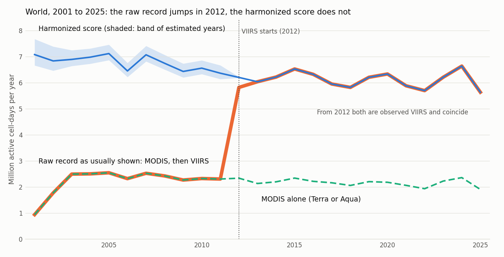

# One additive fire-activity score across MODIS and VIIRS: harmonized active cell-days

**The Hotspots team, NASA Space Apps 2026**
**Method version 1, 2026-11-15** (FIRMS archive up to 2026-11-14)

> **Status**: describes the method as built and measured on 2026-11-15. Every number comes from the build (`data/processed/harmonized/meta.json`, published in part as `method.json` and `manifest.json`) or from the code. Method decisions D1 to D11 are the team's (Appendix A).
>
> **AI disclosure**: drafted by AI assistants from the team's build and documents: Gemini wrote the first text, Claude wrote the fact sheet, fact-checked and corrected it, and Claude Fable reviewed it as a referee. The method decisions are the team's.
>
> **Evidence tags for sources**: [R] read in full, [P] read in part, [S] search snippet only (unverified), [M] from model memory (unverified), [I] our own inference or arithmetic. Details in [Vision Docs/Unified Score Research.md](Vision%20Docs/Unified%20Score%20Research.md).

## Abstract

Satellite records of active vegetation fires span two sensor eras: MODIS on Terra and Aqua since 2000, and VIIRS on S-NPP, NOAA-20 and NOAA-21 since 2012. VIIRS has a much smaller pixel (about 14 ha at nadir against about 100 ha for MODIS) and sees many more fires, so raw counts jump in 2012. S-NPP data delivery ended on 2026-11-02, and Terra and Aqua data collection is planned to end in 2027, so a continuing record must be anchored to VIIRS. We built one additive score from 660 million FIRMS detections: **active cell-days**, the number of (H3 resolution 6 cell, UTC day) pairs with at least one qualifying detection. From February 2012 the score is observed VIIRS (mean of the complete S-NPP and NOAA-20 satellites). Before that, MODIS cell-days are scaled to VIIRS-equivalent units with a ratio of sums per H3 resolution 1 region and season, fitted on 93 overlap months (2012-02 to 2019-12), with a bootstrap band. Global ratios are 2.47 to 3.06 by season. In leave-one-year-out validation, predicted totals are 0.4% above observed. The share of unit-months where MODIS misses activity that VIIRS sees falls with area size, from 53% for single cells to 15% for regions: single cells are unreliable before 2012, large-area totals are not. Because a ratio fixes the mean but not the share of zero months, "more than usual" is judged against a 2012 to 2025 baseline, and estimated months of small places are not classified.

**Key findings**
- Counting days per cell instead of detections, then one ratio per region and season, gives a world series without the 2012 jump (Figure 1).
- The score is an exact sum over cells, so any area and any contribution to a peak is exact.
- Totals are unbiased out of sample; single cells before 2012 are not usable.
- Bias stays within 0.988 to 1.028 by held-out year and within 10% for 87% of regions. Single cells are still not usable.
- The app gives every value a confidence level (section 3.9): high for observed months, medium for estimated months of areas of 49 cells or more, low for smaller areas and for the Terra-only period. Low values are drawn faded and not classified, so a small place no longer shows a drop at 2012 that looks like a change in fire.
- The band covers the year-to-year spread of the ratio, not its change over time: the 2020 to 2025 ratios fall above it in three of four seasons.

## Notation

| Symbol | Meaning |
|---|---|
| $c$, $t$, $D_t$ | an H3 resolution 6 cell, a calendar month, the number of days in $t$ |
| $x_s(c,t)$ | active days of satellite $s$ in cell $c$ and month $t$ |
| $m(c,t)$ | MODIS active days: days seen by Terra or Aqua |
| $v(c,t)$ | VIIRS active days: mean over the complete satellites of {S-NPP, NOAA-20} |
| $k$ | a stratum: H3 resolution 1 region x season |
| $r_k$, $r_k^{\mathrm{Terra}}$ | ratio S-NPP / MODIS, and S-NPP / Terra, in stratum $k$ |
| $h$, $\mathrm{lo}$, $\mathrm{hi}$ | harmonized value and its band for a cell-month |
| $A$, $H(A,t)$ | a place (set of cells) and its summed harmonized value |
| complete | a satellite has data on every day of the month in the record |
| unit | a cell or group of cells used in validation (res 6, res 5, res 4, region) |

## 1. Introduction

MODIS on Terra (from late 2000) and Aqua (from mid 2002) has a nominal 1 km pixel at nadir (about 100 ha), growing to about 2 km by 4.8 km at the swath edge. VIIRS on S-NPP (from January 2012), NOAA-20 (from 2018) and NOAA-21 (from 2023) has a 375 m fire product with a pixel of about 14 ha at nadir (pixel sizes as cited in the team documents, from Schroeder et al. 2014 and the MODIS user guide; not re-read for this paper). VIIRS therefore detects many smaller fires, and a raw count series that crosses 2012 shows a jump that is a sensor change, not a change in fire (Figure 1). A user comparing 2005 with 2024 would read it as a rise in burning.

The record is also changing now. S-NPP VIIRS delivery to FIRMS ended on 2026-11-02 (FIRMS FAQ, as cited in the team documents). Terra and Aqua are running low on fuel and drifting; CAMS reports that Terra data collection is planned to end in January 2027 and Aqua around September 2027 [R, CAMS 2026]. A long record that is to continue has to be expressed in VIIRS terms.

We need one comparable score for three uses:

1. **Comparison across places**, of any size.
2. **Comparison across eras**: a month in 2005 against a month in 2024, for the same place.
3. **Forecasting**: a model trained on the record needs a target in one unit. Fitted across a raw 2012 seam, it would learn the sensor change as a trend.

The score must also be **additive**: the value of any area, at any zoom, must be the exact sum of its parts, so the app can show which cells make up a peak.

In the sources we read, no product merges MODIS and VIIRS active-fire counts into one long index [R, Unified Score Research section 1]. The nearest examples merge burned area, emissions or fire radiative power. GFED5NRT calibrates VIIRS detections to burned area with a ratio per region and land-cover type over 2012 to 2022 [P]. MRBA60 adjusts a MODIS burned-area product to a Sentinel-3 one with random forests and empirical quantile mapping [R]. For VIIRS and MODIS burned area, Giglio et al. (2025) find that "simple concatenation ... at local scales is not advisable for long-term trend analyses but may be acceptable at the broad scales of some GFED regions", and that a single harmonized record "could be successfully generated at local scales through their statistical inter-calibration" [R]. INPE avoids the problem by using one reference satellite (Aqua, afternoon pass) for all comparisons [R]. EFFIS is reported to start the baseline of its MODIS and VIIRS thermal-anomaly charts in 2012 [S, unverified].

This paper describes the method built into The Hotspots: the unit (section 3.1), the sensor groups (3.2), the ratio transfer (3.3 to 3.6), the baseline and classes (3.7, 3.8), and its validation (section 4).

**Figure 1.** World totals per year, 2001 to 2025, from the published `summary/global.json`. Orange: the raw record as maps usually stitch it (MODIS until 2012-01, VIIRS from 2012-02). Green, dashed: MODIS alone over the whole period. Blue: the harmonized score, with its band (shaded) for estimated years. From 2012 the harmonized score is observed VIIRS, so it lies on the orange line. 2001 and 2002 are low on the raw lines because only Terra flew for most of them. The harmonized world total is about 6.4 to 7.1 million cell-days per year before 2012 and 5.6 to 6.6 million after; we do not attribute this difference here (see limitation 4). Script: `scripts/whitepaper_figure.py`.

## 2. Data

All data come from the NASA FIRMS active-fire archive, November 2000 to 14 November 2026. Archive products, by folder name: MODIS Collection 6.1 (`M-C61`, Terra and Aqua), and VIIRS 375 m Collection 2 for S-NPP (`SV-C2`), NOAA-20 (`J1V-C2`) and NOAA-21 (`J2V-C2`). The archive covered every month of the record (with near-real-time files for the last months), so no FIRMS API months were used, although the build can take them for months an archive lacks. In all, 59 CSV files (about 50 GB) and 660 million detections.

**Filters (D11).**
- Only nominal and high confidence detections count, for both sensors. MODIS confidence (0 to 100) is mapped to the VIIRS classes: low below 30, nominal 30 to 79, high 80 and above.
- Only type 0 (presumed vegetation fire). Volcanoes, other static land sources and offshore detections are removed.
- Near-real-time (NRT) files, used for 2026-08 to 2026-11, have no type column. Instead, a static mask removes the H3 resolution 6 cells where at least half of the 2021 to 2025 standard-product detections were not type 0 (21,963 cells). These months are marked **provisional**.

**Grid and day (D10).** Each detection is assigned to an H3 resolution 6 cell (mean area about 36 km²) and to its UTC acquisition date. H3 is a hierarchical hexagonal grid. Its cells are close to, but not exactly, equal in area. For each (cell, month, satellite) the build stores a 31-bit day mask.

Satellite dates measured in the files:

| Satellite | First data | First complete month |
|---|---|---|
| Terra | 2000-11 | 2000-11 |
| Aqua | 2002-07-04 | 2002-10 |
| S-NPP | 2012-01-20 | 2012-02 |
| NOAA-20 | 2018-04 | 2018-04 |
| NOAA-21 | 2023-03 | 2023-03 |

## 3. Method

### 3.1 The unit: active cell-days

For a resolution 6 cell $c$, a month $t$ with $D_t$ days and a satellite $s$, $x_s(c,t)$ is the number of UTC days in $t$ on which $s$ had at least one qualifying detection in $c$:

$$x_s(c,t) \in \{0, 1, \dots, D_t\}$$

Section 3.2 combines satellites into a MODIS value $m$ and a VIIRS value $v$, and section 3.3 turns them into one harmonized value $h$. For any area $A$ (a set of resolution 6 cells), the value is the plain sum:

$$H(A,t) = \sum_{c \in A} h(c,t)$$

Coarser H3 cells, preset places and drawn areas are all sums of this kind. A drawn shape takes the whole cells it overlaps, with no area weighting (D15).

**Why days and not detections.** VIIRS splits one fire into many small detections. In a cell of about 36 km² it is still one day. Counting days removes most, not all, of the pixel-size difference. The rest is handled by the ratio in 3.3.

**Exact sums.** Values are stored as integers in tenths of a cell-day, so every sum of published cells is exact.

**Reading.** "41 active cell-days" means fire was seen on 41 cell-days in that month in the area. It measures how widespread and persistent burning was, not burned area.

### 3.2 Sensor groups

**MODIS.** $m(c,t)$ is the number of days seen by Terra **or** Aqua (bitwise OR of the two day masks):

$$m(c,t) = \left|\, \mathrm{days}_{\mathrm{Terra}}(c,t) \cup \mathrm{days}_{\mathrm{Aqua}}(c,t) \,\right|$$

Before 2002-10, Aqua is not complete, and the MODIS side is Terra alone (section 3.4).

**VIIRS.** The published VIIRS value is the **mean** over the satellites of {S-NPP, NOAA-20} that are complete in month $t$ (data on every day of the month in the record):

$$v(c,t) = \frac{1}{|S_t|} \sum_{s \in S_t} x_s(c,t)$$

If neither is complete, the ones with any data are used. NOAA-21 is held back (shown per satellite only) until its values are checked, as GFED5NRT also does [P]. After 2026-11-02 the series is NOAA-20 alone. Since 2018-04, 15 months use one satellite because the other missed a day: 2022-07, 2022-08, 2023-07, 2023-09, 2024-02, 2024-05, 2024-06, 2024-07, 2024-09, 2024-11, 2026-03, 2026-04, 2026-06, 2026-07, 2026-11. Because of the mean, $v$ takes half values from 2018.

**Why a mean for VIIRS.** Each extra overpass raises the chance of seeing a fire on a given day. A union across VIIRS satellites would raise cell-days whenever a satellite is added, with no change in fire. GFED5NRT averages S-NPP and NOAA-20 the same way [P].

**Why a union for MODIS.** Terra and Aqua flew together over the whole period estimated from both (from 2002-10). What matters is that the MODIS side is defined the same way in the fit years and in the years it is applied to. The ratio then absorbs the difference between the union and the VIIRS mean [I].

**The VIIRS satellite steps.** In months where both are complete, NOAA-20 sees 1.022 times the cell-days of S-NPP. So the published mean steps up by about x1.011 when NOAA-20 joins (2018-04), and again by about x1.011 when S-NPP ends (2026-11, NOAA-20 alone). A scale from NOAA-20 to S-NPP units is fitted per region and season (global: DJF 0.980, MAM 0.979, JJA 0.973, SON 0.981, bands within about 1%) but not applied (D2). NOAA-21 sees 0.975 times NOAA-20. The mean keeps the level but not necessarily the share of zero months, which may change at 2018-04; this was not measured.

### 3.3 Ratio transfer

**Example.** A place where MODIS saw fire on 10 cell-days in July 2005, in a region using the global JJA ratio of 2.47, gets an estimate of about 24.7 VIIRS-equivalent cell-days.

**Reference (D2).** S-NPP alone is the fit reference. The first complete S-NPP month is 2012-02.

**Fit period (D3).** 2012-02 to 2019-12: 95 months, of which 93 are used. 2012-03 and 2016-02 are dropped because S-NPP, Terra or Aqua missed a day. These months come from 8 calendar years (2012 to 2019); 2012 contributes 10 months.

**Strata (D6).** An H3 resolution 1 region (about 609,000 km²) crossed with a 3-month season: DJF, MAM, JJA, SON. The seasons are the same calendar months everywhere.

**Ratio.** For stratum $k$:

$$r_k = \frac{\sum_{(c,t) \in k,\; t \in T_{\mathrm{fit}}} x_{\mathrm{S\text{-}NPP}}(c,t)}{\sum_{(c,t) \in k,\; t \in T_{\mathrm{fit}}} m(c,t)}$$

**Fallback.** If the MODIS sum of a stratum over the fit period is below 30 cell-days, the stratum takes the ratio of its resolution 0 parent (one of 122 base cells) for that season. If that is also below 30, it takes the global ratio for that season. In this build, 1,198 region-seasons use their own ratio, 400 the resolution 0 ratio and 466 the global one.

**Harmonized value.**

$$h(c,t) = \begin{cases} r_k^{\mathrm{Terra}} \cdot x_{\mathrm{Terra}}(c,t) & t < \text{2002-10} \quad \text{(estimated)} \\ r_k \cdot m(c,t) & \text{2002-10} \le t < \text{2012-02} \quad \text{(estimated)} \\ v(c,t) & t \ge \text{2012-02} \quad \text{(observed; provisional from 2026-08)} \end{cases}$$

Note that 2012-01 is estimated: S-NPP data starts on 2012-01-20, so that month is not complete. An estimated month answers: "about how many cell-days would VIIRS have seen?"

### 3.4 Terra-only period (D5)

Until Aqua has data on every day of a month (2002-10), only Terra is complete. Terra alone sees far fewer cell-days than Terra and Aqua together (Table 1). A ratio fitted on the union would underestimate these months. So a separate ratio $r_k^{\mathrm{Terra}}$ is fitted the same way, over the same 93 months and strata, with Terra alone in the denominator:

$$r_k^{\mathrm{Terra}} = \frac{\sum_{(c,t) \in k,\; t \in T_{\mathrm{fit}}} x_{\mathrm{S\text{-}NPP}}(c,t)}{\sum_{(c,t) \in k,\; t \in T_{\mathrm{fit}}} x_{\mathrm{Terra}}(c,t)}$$

This is the weakest part of the record (limitation 6).

### 3.5 Uncertainty band

The 8 fit years are resampled with replacement 200 times (seed 1). For each draw the stratum ratio is recomputed from the drawn years. $r_{k,\mathrm{lo}}$ and $r_{k,\mathrm{hi}}$ are the 5th and 95th percentiles of the draws, widened if needed to contain $r_k$. This is a nominal 90% percentile-bootstrap interval for the regional ratio. For estimated months:

$$\mathrm{lo}(c,t) = r_{k,\mathrm{lo}} \cdot m(c,t), \qquad \mathrm{hi}(c,t) = r_{k,\mathrm{hi}} \cdot m(c,t)$$

(with the Terra-only band and $x_{\mathrm{Terra}}$ before 2002-10). For observed months, $\mathrm{lo} = \mathrm{hi} = h$.

What the band does not cover:
- **Error for a single cell or place.** Section 4.2 shows that this error is much larger than the band.
- **Change of the ratio over time.** The 2020 to 2025 global ratios fall above the 2012 to 2019 band in three of four seasons (Table 1), and the ratio is applied up to 11 years before the fit period.
- **Few years.** With only 8 resampled years, a percentile bootstrap is likely to be too narrow [M].
- **Areas across strata.** Their lo and hi are sums of the stratum bands, which assumes the stratum errors move together.

### 3.6 Additivity

Inside a stratum every cell gets the same multiplier. For an area $A$ inside stratum $k$, before rounding:

$$\sum_{c \in A} r_k \, m(c,t) = r_k \sum_{c \in A} m(c,t)$$

So harmonizing the cells and then summing gives the same total as summing MODIS and then harmonizing. An area that crosses strata is the sum of its per-stratum parts. The same holds for $\mathrm{lo}$ and $\mathrm{hi}$. The stored values are rounded to 0.1 per cell, so this identity holds to within 0.05 cell-days per cell-month. The published sums of stored cells are exact.

A non-linear transfer such as empirical quantile mapping (MRBA60) does not have this property: the mapped value of a sum is not the sum of the mapped values. Keeping every area an exact sum of its cells is the main reason for the plain ratio (D1).

### 3.7 Baseline and classes (D4, D7)

**Baseline.** For a month $t$ of a place $A$, the comparison values are $H(A, \cdot)$ for the same calendar month in **2012 to 2025**, leaving out the target year and partial months. At least 10 years are required. The place is summed first and then compared, so the normal belongs to the whole place. Estimated months are skipped, so all baseline months are observed VIIRS. January 2012 is estimated (section 3.3) and is left out, so January has one comparison year fewer.

**Percentiles.** Linear interpolation between order statistics (type 7, the default of R and NumPy). The **normal** is the median.

**Classes.** The rules are checked in this order (`web/src/stats/classify.ts`):

| Order | Class | Rule |
|---|---|---|
| 1 | month not complete | the month is partial (the newest month) |
| 2 | not enough years | fewer than 10 baseline years |
| 3 | usually none | normal is 0 (two sentences: none this year, or activity this year) |
| 4 | much more than usual | $\mathrm{lo}(A,t) > p_{90}$ |
| 5 | more than usual | $\mathrm{lo}(A,t) > p_{75}$ |
| 6 | quieter than usual | $\mathrm{hi}(A,t) < p_{25}$ |
| 7 | usual | otherwise |

Then a low-confidence month (section 3.9: an estimated month of a place of fewer than 49 cells, or any month before 2002-10) that reached step 3 or later gets "estimated, not compared" instead (section 3.8).

For observed months $\mathrm{lo} = \mathrm{hi} = H$. For estimated months, the low end of the band must clear an upper threshold and the high end must fall below the lower one. This stops the band itself from producing a class. It is not a strong safeguard: the band is much narrower than the real error of small places (section 3.5), which is why section 3.8 exists. The US Drought Monitor uses a related idea: its top category needs agreement across indicators [R].

**Zero normal.** If the median is 0, the app does not compute a ratio. It says, for example, "Usually no fire activity in March", with the month's value and the number of other years with activity.

**Ratio wording.** "About twice the usual" and similar phrases are used only for the two upper classes and only when the normal is at least 3 cell-days.

**How often.** January baselines have 12 comparison years. With 13 comparison years, $p_{90}$ lies 0.8 of the way from the third highest to the second highest value, $p_{75}$ is the fourth highest and $p_{25}$ the fourth lowest. If years are exchangeable and there are no ties, a month from the same distribution lands in "much more than usual" about 16% of the time, in one of the two upper classes 29%, in "quieter than usual" 29% and in "usual" 43% [I]. Ties at zero, common in small places, change these shares. 13 or 14 years cannot support classes finer than about the top 10%.

**Why 2012 to 2025.** A regional ratio corrects the mean, not the share of zero months (section 4.3). A baseline that mixed estimated MODIS-era years with observed VIIRS years would hold too many zeros for small places. Recent observed months would then look unusual too often. INPE compares within one reference satellite [R], and EFFIS reportedly starts its thermal-anomaly baseline in 2012 [S]. The cost is a shorter baseline: 13 to 14 years instead of 22 to 23.

### 3.8 Small places before 2012

For places of fewer than 49 resolution 6 cells (about 1,800 km²), estimated months show the value with an "estimated" marker, a low confidence level (section 3.9) and **no class** ("estimated, not compared"). The evidence is in sections 4.2 and 4.3: in small areas MODIS misses many small fires, so estimated months have too many zeros and their non-zero values are too large. The same holds for months before 2002-10 at every size (section 3.9). 49 cells is a setting (`estimatedCompareMinCells`).

### 3.9 Confidence levels (D27)

The app gives each value of a place, the world series or a map cell one of three levels. It is computed from the month status, the month and the area in resolution 6 cells, so it needs no data field (`web/src/stats/confidence.ts`).

| Level | Rule | Display |
|---|---|---|
| High | observed (2012-02 on), not provisional | as before |
| Medium | estimated, area of 49 cells or more (and the world series); or provisional | hatch (estimated) or dots (provisional), full fill |
| Low | estimated, area under 49 cells; or estimated before 2002-10 at any size | faded fill (40% of the normal opacity) under the hatch, "Low confidence" marker and one line of text, no class |

A map cell of resolution $r$ counts as $7^{6-r}$ resolution 6 cells, so in estimated months resolutions 5 and 6 are low and resolutions 3 and 4 medium. The raw MODIS and VIIRS views show what a sensor saw and carry no level.

**Why 49 cells.** Table 2 shows no size where the estimate becomes good for a single month: the share of active unit-months that MODIS missed falls from 53% (resolution 6) to 47% (7 cells) and 41% (49 cells), and only reaches 15% for resolution 1 regions; the 75th percentile of non-zero estimates stays about twice the observed one up to 49 cells (6.3 / 3.0, 13.6 / 7.0, 27.3 / 14.0) and is 1.24 times at region size (927 / 749). Totals are unbiased (1.004; 0.988 to 1.028 by held-out year; 87% of regions within 10%), so the errors cancel as the area grows. The zero-share gap of section 4.3 (9.35 points at 7 cells) has the same cause. 49 cells is one resolution 4 cell, the finest size where the map already shows estimated cells as a regional picture, and the size the classes have used since the start. Medium therefore means "area totals are usable", not "each month is right".

**Why the Terra-only period is low at every size.** Before 2002-10 the estimate rests on one satellite and a ratio of 7.3 to 8.2 (section 3.4), with no out-of-sample check, and Terra outage months are not corrected (2001-06: 15 of 30 days missing). A larger area does not remove these errors, so there is no size at which the medium level is supported.

**Why not a numeric interval.** The band of section 3.5 is the year-to-year spread of the regional ratio (median relative half-width 0.089). It is far narrower than the error of a small place and cannot show the missed zeros, so it is not used to set the level. A per-place interval would need a check against VIIRS before 2012, which does not exist (limitation 1).

## 4. Results and validation

### 4.1 Ratios

**Table 1.** Global ratios by season. Bands are 5th to 95th percentiles of 200 bootstrap draws over the fit years.

| Season | S-NPP / MODIS, 2012-2019 | Band | S-NPP / MODIS, 2020-2025 (not applied) | S-NPP / Terra, 2012-2019 | Band |
|---|---|---|---|---|---|
| DJF | 2.903 | 2.869 to 2.931 | **2.999** | 7.573 | 7.409 to 7.707 |
| MAM | 3.059 | 3.002 to 3.110 | **3.115** | 8.208 | 7.969 to 8.443 |
| JJA | 2.472 | 2.451 to 2.495 | **2.498** | 7.361 | 7.170 to 7.589 |
| SON | 2.837 | 2.798 to 2.887 | 2.872 | 7.289 | 7.070 to 7.568 |

Bold: outside the 2012 to 2019 band.

- VIIRS sees about 2.5 to 3.1 times as many cell-days as MODIS worldwide, depending on season.
- **Drift.** The 2020 to 2025 fit is 1% to 3% higher, and outside the band in three seasons. This is consistent with the known drift of Terra and Aqua after about 2020, but the comparison alone cannot separate drift from other changes [I]. That fit is reported, not applied (D3).
- **Terra-only.** Terra alone needs a ratio of 7.3 to 8.2, so without its own ratio the Terra-only period would be underestimated by a factor of about 2.6 to 3.0 [I, from Table 1].
- **Regional ratios.** Over the 1,198 resolution 1 strata that use their own ratio, the ratio runs from 0.71 to 41.7, with median 3.41 and 10th to 90th percentiles 1.84 to 7.40 (`meta.json` `ratios`). Their bands, as relative half-width $(r_{\mathrm{hi}} - r_{\mathrm{lo}}) / 2r_k$, have median 0.089, 90th percentile 0.31 and maximum 4.7; 46 strata are above 0.5 and 17 above 1. Global ratios: 0.009 to 0.018. A map of the regional ratios is not yet made (the values are in `method.json`).

### 4.2 Leave one year out (D9)

For each of the 8 fit years, all ratios (with their fallbacks) are refitted without that year. The held-out year's S-NPP cell-days are predicted as ratio times MODIS and compared with what S-NPP saw. Units are summed at four sizes. Only unit-months where prediction or observation is above 0 are counted.

**Table 2.** Leave-one-year-out results by unit size. Bias (sum predicted / sum observed) is 1.004 at every size.

| Unit | Area | Unit-months | Mean abs. error (cell-days) | Summed abs. error (million cell-days) | Predicted 0, observed > 0 | 75th pct, pred / obs (separately over pred > 0 and obs > 0) |
|---|---|---|---|---|---|---|
| Res 6 cell | about 36 km² | 19.9 million | 2.12 | 42.2 | 53% | 6.3 / 3.0 |
| Res 5 cell (7 res 6) | about 250 km² | 7.5 million | 3.61 | 27.1 | 47% | 13.6 / 7.0 |
| Res 4 cell (49 res 6) | about 1,800 km² | 2.4 million | 7.43 | 18.2 | 41% | 27.3 / 14.0 |
| Res 1 region | about 609,000 km² | 32,039 | 176.9 | 5.7 | 15% | 927 / 749 |

(Summed absolute error = mean absolute error x unit-months.)

- **Totals are unbiased.** Predicted totals are 0.4% above observed. The bias is the same at every size because it is a ratio of sums, and sums do not depend on how cells are grouped. A pooled ratio of sums is close to 1 almost by construction, so this number shows that the ratio is stable across years, not that it is accurate for a place. The breakdown below shows the same by held-out year, season and region.
- **Small units are not.** Among resolution 6 cell-months with activity on either sensor, 53% had nothing on MODIS but fire on S-NPP. Since totals are unbiased and so much activity is missed, the predictions that are not zero must on average be too high. The 75th percentiles agree: about twice the observed one from resolution 6 to 4, 1.24 times at region size. (They are taken over different sets, so this is an indication, not a paired comparison.)
- **Error falls with area.** Mean absolute error per unit grows with area, but the summed absolute error falls from 42.2 to 5.7 million cell-days and the missed share from 53% to 15%. At about 1,800 km² the missed share is still 41%. Large-area totals are the reliable figure; single estimated cells are not.
- **By year, season and region.** Bias (sum predicted / sum observed) by held-out year ranges from 0.988 to 1.028 (Table 3). The mean absolute error at resolution 4 ranges from 7.19 to 7.71 cell-days across held-out years. By season, bias is 1.002 for DJF and 1.004 for MAM, JJA and SON. Over the 350 resolution 1 regions with at least 100 observed cell-days in the fit months, the bias has a 10th percentile of 0.937, a median of 1.005 and a 90th percentile of 1.033. 87.4% of these regions are within 10% of 1. The numbers are in `loyo_breakdown` in `meta.json` and `method.json`.
- **Remaining caveat.** Folds are calendar years, so December and the following January of one fire season fall in different folds.

**Table 3.** Leave-one-year-out bias by held-out year.

| Held-out year | Bias (sum predicted / sum observed) |
|---|---|
| 2012 | 1.028 |
| 2013 | 0.994 |
| 2014 | 0.988 |
| 2015 | 1.011 |
| 2016 | 1.004 |
| 2017 | 1.010 |
| 2018 | 0.989 |
| 2019 | 1.008 |

### 4.3 The zero-share gap (the measurement behind D4)

On 7-cell places (the 7 resolution 6 cells of a resolution 5 cell) with any activity in the fit months, over 33.3 million place-months:

- no activity in 88.1% of place-months on MODIS, against 78.7% on S-NPP: a gap of 9.35 points;
- MODIS zero while S-NPP active: 10.6% of place-months.

By resolution 1 region (463 regions): the gap is over 10 points in 146 regions (holding 44% of the places), 5 to 10 points in 100, and under 5 points in 217. Median 5.6 points.

A ratio scales non-zero values and leaves zeros at zero. It cannot close this gap. This is why the baseline uses observed years (3.7) and why estimated months of small places are not classified and have low confidence (3.8, 3.9). A map of the gap by region is not yet made (values in `meta.json` `d4_zero_share`).

### 4.4 Outages and satellite changes

- **Detection.** Outages are found from the files: a missing day, or a day with fewer than 40% of the satellite's median daily rows. The median is taken over a centred 91-day window, so a long outage does not lower its own reference. `meta.json` lists 67 satellite-months, merged into 54 known-issue ranges in the manifest. They are shown as known issues, for display only: values and complete months do not depend on them.
- **In the baseline years.** 37 of these satellite-months fall in 2012 to 2025. 19 are S-NPP or NOAA-20 and can change a baseline value: S-NPP 2012-03, 2012-06, 2022-06, 2022-07, 2022-08, 2023-07, 2023-11, 2024-01, 2024-05, 2024-06, 2024-07, 2024-09, 2024-11, 2025-07, 2025-11; NOAA-20 2023-07, 2023-09, 2023-10, 2024-02. The other 18 are Terra, Aqua or NOAA-21 and do not enter $h$ after 2012. The 19 are not removed from baselines (limitation 9).
- **Against Giglio et al. (2025).** Their two largest MODIS and VIIRS discrepancies match outages: Aqua in August 2020 (15 days) and S-NPP in July and August 2022 [R]. Our detector finds S-NPP 2022-07 and 2022-08 (5 and 10 missing days), and it flags all of the Aqua outage: 15 low days in 2020-08 and 2 in 2020-09. The earlier rule compared each day with the month's own median and found only 2 days, because the outage filled half of August and pulled that median down.
- **Terra outages before 2002-10** are not corrected: 2001-06 has 15 of 30 days missing, 2002-03 has 8 of 31. Those estimates read low.
- **VIIRS steps** at 2018-04 and 2026-11 are about 1% (section 3.2), small against the 2.5 to 3.1 ratio between sensor families.

## 5. Discussion

**What the score supports.**
- Area totals in one unit for 26 years and four satellites (NOAA-21 shown separately), with a band for estimated months.
- Comparison of the same large area across eras (2005 against 2024), with the band shown for 2005.
- Comparison across places of different size as density (cell-days per 1,000 km²; the map uses fixed steps at 1, 5, 25, 100 and 300).
- Exact contributions: each cell's share of an area's peak is its value over the total.
- A single target for forecasting (section 6).

**What it does not support.**
- Single resolution 6 cells before 2012. Where MODIS saw nothing the estimate is zero, and where it saw something the estimate can exceed the number of days in the month.
- Classes for estimated months of small places, or for the Terra-only period (sections 3.8 and 3.9).
- Comparing the height of a low-confidence month (section 3.9) with a later year.
- Trend claims across 2012 without the band and the caveats of section 7.

**Relation to other methods.**
- **GFED5NRT** (Chen et al., 2026) uses the same family of method: a ratio per region and land-cover type, fitted on the overlap. It also averages S-NPP and NOAA-20 and holds NOAA-21 back [P]. It gives no numeric uncertainty, and its overlap metrics appear to be computed on the fitting years (our reading, [I]). We add a bootstrap band and an out-of-sample check.
- **MRBA60** (Torres-Vázquez et al., 2026) uses random forests with climate and vegetation predictors, then quantile mapping, with leave-one-year-out validation [R]. Quantile mapping fixes the distribution, including zeros, but does not keep sums. Random forests need driver data we did not have in the time available. We kept its leave-one-year-out check.
- **VNP64A1 against MCD64A1** (Giglio et al., 2025) warns against plain concatenation at local scales, says it may be acceptable at broad scales, and notes that agreement at coarse cells can hide errors that cancel out [R]. Table 2 shows the same pattern for active cell-days. Our rules (2012 to 2025 baseline, no class for small estimated places) follow from it.
- **INPE** keeps one reference satellite (Aqua) [R]. That keeps the record consistent but cannot continue unchanged when Aqua ends. We did not find INPE's plan for after Aqua.

**Why VIIRS as reference.** It continues after MODIS ends (NOAA-20 and NOAA-21 are flying), and it is the more sensitive sensor, so the record is expressed in the units of the data users will see from now on.

## 6. Use for forecasting (proposed, not built)

None of this section is implemented. It shows what the common unit makes possible. The plan is in [Vision Docs/Product Roadmap.md](Vision%20Docs/Product%20Roadmap.md).

1. **Empirical outlook.** From the 2012 to 2025 baseline of a place and month: the share of years with any activity, and the median with the 25th to 75th percentile. It must beat "same as last year" and "always the median" in leave-one-year-out tests, or it is not shown.
2. **Hurdle regression on the harmonized score.** The target $Y(A,t)$ has many zeros, so the model returns a distribution in two parts:

$$P\big(Y(A,t) > 0\big) = \mathrm{logit}^{-1}\!\left(\mathbf{x}_{A,t}^{\top} \beta_1\right)$$

$$Y(A,t) \mid Y(A,t) > 0 \;\sim\; \text{zero-truncated negative binomial}\left(\mu = \exp(\mathbf{x}_{A,t}^{\top} \beta_2),\ \theta\right)$$

The harmonized value is not an integer (half values from 2018, scaled values before 2012), so a count model needs a rounded target, or the per-satellite integer counts as target. Features from the harmonized history only: season, the place's baseline, recent anomalies, the same month last year, a trend term and the region. Train on observed years (2012 on), or give estimated years a lower weight and test whether they help. Validate by rolling origin with the Brier score for $P(Y > 0)$ and $P(Y > p_{90})$ and the ranked probability score for the whole distribution [M for the scores]. Keep it only if it beats the empirical outlook.

A common unit is a precondition for both: without it, a model fitted across 2012 would learn the sensor change as a trend.

## 7. Limitations

1. **Single estimated cells** are unreliable (too many zeros, non-zero values too large). Only large-area totals should be read before 2012. This cannot be fixed with the data available: where MODIS saw nothing, the record holds no information, so no ratio can recover fires that MODIS did not detect, and VIIRS did not exist before 2012 to check any correction against. In the app, these months have the low confidence level (section 3.9): no class, a faded fill under the estimated hatch in the time strip, the calendar and the map (resolutions 5 and 6), and a line that says heights are not comparable with later years. The bar heights are still the estimate, because no better number exists; the display only stops them from reading as comparable.
2. **The band** is a nominal 90% interval for the regional ratio from 8 resampled years. It does not cover the error for a place, nor the change of the ratio over time (section 3.5).
3. **UTC days.** The day is the UTC date, not the local date. Depending on longitude, the day and night overpasses of one local day can fall on two UTC dates, or passes of two local days on one. The ratio absorbs this on average, not per cell.
4. **Fixed ratio over time.** The ratio from 2012 to 2019 is applied to 2000 to 2012. Any change in the MODIS to VIIRS relation before 2012 cannot be measured, because VIIRS did not exist. The 2020s ratios are higher and outside the band (Table 1). So part of the difference between pre-2012 and post-2012 world totals in Figure 1 may come from the method, not from fire.
5. **The leave-one-year-out check** uses S-NPP as the observed value, not the published S-NPP and NOAA-20 mean, and covers the MODIS ratio only. The breakdown by year, season and region is in section 4.2.
6. **Terra-only period (before 2002-10).** It rests on one satellite and ratios of 7.3 to 8.2, with no out-of-sample check. Terra outage months (2001-06: 15 of 30 days missing) are not corrected and read low.
7. **No land-cover strata.** GFED5NRT stratifies by land cover; we stratify by region and season only.
8. **Same seasons everywhere.** DJF to SON are the same calendar months in both hemispheres and the tropics.
9. **Outage months** stay in the baselines (19 S-NPP or NOAA-20 satellite-months in 2012 to 2025).
10. **NRT months** rely on a static type mask and are provisional.
11. **VIIRS steps** of about 1% at 2018-04 and 2026-11 are not corrected, and the change in zero share when NOAA-20 joins was not measured.
12. **Short baseline.** 13 to 14 years support only coarse classes, and percentile classes drift if the fire regime changes (drought.gov reports this for drought categories [R]).
13. **No change-point test** has been run at the sensor transitions. The app's seam check (`web/src/stats/seam.ts`: mean of 36 months after a seam over the 36 months before, on the raw and the harmonized series) describes the step; it is not a test.

## 8. Reproducibility, data and code availability

- **Code**: https://github.com/AlonResearch/the-hotspots, `pipeline/` (Python and DuckDB with the H3 extension). `build.py` runs `normalize.py`, `grid.py`, `harmonize.py`, `publish.py`, then the contract checks (`npm run validate-data`). The app's baseline, classes and wording are in `web/src/stats/`. Figure 1: `scripts/whitepaper_figure.py`.
- **Version**: method version 1, the build of 2026-11-15 (data up to 2026-11-14). The published `method.json` and `manifest.json` carry the settings of the build. No licence has been chosen yet; that is for the team.
- **Settings**: every value in this paper (fit period, strata, fallback threshold, band, baseline, classes, filters) is a setting in `pipeline/config.toml` or `web/src/stats/config.ts`. Changing one is a config edit and a rebuild.
- **Measurements**: `data/processed/harmonized/meta.json` holds every number quoted here. The published `method.json` carries the ratio table, the leave-one-year-out table and its breakdown by year, season and region (`loyo_breakdown`). The app shows the first two in scientific mode.
- **Input data**: NASA FIRMS archive downloads (product folders listed in section 2); no FIRMS API months were needed for this build. The raw files are not redistributed in the repository.
- **Run time** on one laptop: normalize 141 s, grid 125 s, harmonize 223 s, publish 361 s. The published data is 2.6 GB in 47,305 files, with place history for every active resolution 3 cell in the world (13,183 detail tiles).
- **How to run**: [pipeline/README.md](pipeline/README.md).
- **How to cite**: The Hotspots team (2026). One additive fire-activity score across MODIS and VIIRS: harmonized active cell-days. Method version 1, 2026-11-15. https://github.com/AlonResearch/the-hotspots

## Appendix A. Method decisions (team, 2026-11-15)

| # | Decision |
|---|---|
| D1 | Plain ratio transfer to a VIIRS-equivalent score |
| D2 | S-NPP alone as fit reference. Published VIIRS: mean of the complete S-NPP and NOAA-20. NOAA-21 held back. NOAA-20 to S-NPP scale fitted, not applied |
| D3 | Fit 2012-02 to 2019-12. The 2020 to 2025 fit is reported only |
| D4 | Baseline 2012 to 2025, target year excluded, at least 10 years |
| D5 | Separate Terra-only ratio before 2002-10 |
| D6 | H3 resolution 1 region x season. Below 30 MODIS cell-days: resolution 0 parent, then global |
| D7 | Classes at the 25th, 75th and 90th percentiles, judged on the band. Ratio wording from a normal of 3 |
| D9 | Leave-one-year-out: bias, mean absolute error, missed-activity share, 75th percentiles, by unit size |
| D10 | UTC acquisition date |
| D11 | Nominal and high confidence, type 0. NRT months: static mask, provisional |
| D27 | Confidence levels in the app (section 3.9): low for estimated areas under 49 cells and for the Terra-only period, medium for larger estimated areas and provisional months, high for observed. Decided by the user on 2026-11-15 |

D8 (where place history is published: now the whole world) and D12 to D17 concern the app and the map, not the score, and are left out here. The full list is in section 13 of [Vision Docs/MVP Implementation Plan.md](Vision%20Docs/MVP%20Implementation%20Plan.md). The section "How the fire score works" of [Contributor.md](Contributor.md) explains each decision for a general reader.

## References

Tags give how much of each source was read. Full notes are in [Vision Docs/Unified Score Research.md](Vision%20Docs/Unified%20Score%20Research.md), section 2.

1. Chen et al. (2026). GFED5NRT. *Earth System Science Data* 18, 7535. https://essd.copernicus.org/articles/18/7535/2026/ [P]
2. Chen et al. (2023). GFED5. *Earth System Science Data* 15, 5227. https://essd.copernicus.org/articles/15/5227/2023/ [P]
3. Giglio et al. (2025). Validation of VNP64A1 and intercomparison with MCD64A1. *Remote Sensing of Environment* 331, 115006. https://geog.umd.edu/sites/geog.umd.edu/files/pubs/1-s2.0-S0034425725004109-main.pdf [R]
4. Torres-Vázquez et al. (2026). MRBA60. *Scientific Data* (article in press). https://doi.org/10.1038/s41597-026-07959-w [R]
5. CAMS (25 February 2026). Drifting away from MODIS. https://atmosphere.copernicus.eu/drifting-away-modis-cams-global-fire-assimilation-system [R]
6. ECMWF. GFAS v1.4.2 and v1.2 documentation. https://confluence.ecmwf.int/spaces/CKB/pages/601301528 and https://confluence.ecmwf.int/spaces/CKB/pages/88247734 [R]
7. INPE Programa Queimadas: situation and statistics pages (https://data.inpe.br/queimadas/situacao_atual/) [R]; INFOQUEIMA bulletin, September 2025 [P]; TerraBrasilis change history [R].
8. EFFIS. Fire danger forecast, technical background. https://forest-fire.emergency.copernicus.eu/about-effis/technical-background/fire-danger-forecast [R]
9. National Drought Mitigation Center. US Drought Monitor tutorial, section 5. https://drought.unl.edu/Education/Tutorials/Usdm/section-five.aspx [R]
10. NIDIS, drought.gov (2024). Emerging climate trends make monitoring drought more complex. https://www.drought.gov/news/emerging-climate-trends-make-monitoring-drought-more-complex-2024-05-28 [R]
11. NOAA CPC. Long-lead tools. https://www.cpc.ncep.noaa.gov/products/predictions/long_range/tools.html [R]
12. Schroeder et al. (2014), VIIRS 375 m active fire algorithm, *Remote Sensing of Environment*; Giglio et al. (2016), MODIS Collection 6 active fire algorithm, *Remote Sensing of Environment*; NASA MODIS user guide. Pixel sizes as cited in the team documents (`Vision Docs/Personas.md`, `Vision Docs/CurrentSolutionLandscape.md`). Not re-read for this paper: treat as [M].
13. EFFIS statistics portal (2012 to 2025 baseline for MODIS and VIIRS thermal anomalies). [S, unverified: search snippet only]
14. NASA FIRMS. https://firms.modaps.eosdis.nasa.gov/download/ and FAQ https://www.earthdata.nasa.gov/data/tools/firms/faq. S-NPP delivery end date as cited in the team documents; not re-read for this paper: treat as [M].
